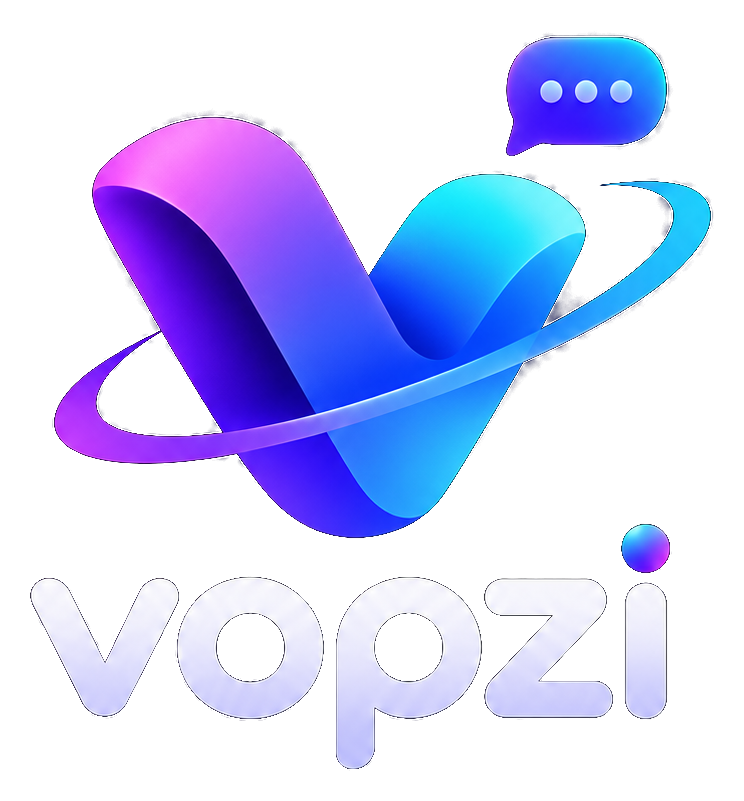
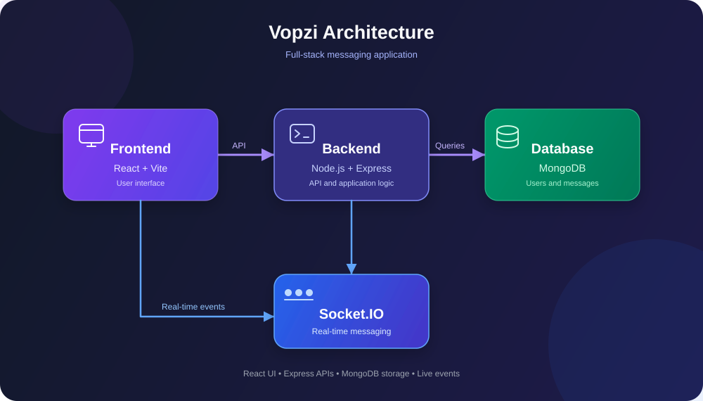

<p align="center">
  
</p>

<p align="center">
  
</p>

<p align="center">
  <b>Chat • Connect • Be You</b>
  <br />
</p>

<p align="center">
  <a href="https://github.com/KumarShrey05/vopzi">
    
  </a>
</p>

<p align="center">
  
  
  
  
  
</p>

---

### ✦ The Experience

Vopzi brings people together through a clean, modern messaging interface. Built as a full-stack project, it combines responsive frontend development, backend APIs, authentication, database integration, and real-time communication.

### ✧ Key Features

| Feature | Description |
|---|---|
| 💬 Real-Time Messaging | Live communication using Socket.IO |
| 🔐 Authentication | JWT-based user authentication |
| 👥 Contacts | Connect with other users |
| 🗄️ Data Persistence | MongoDB database integration |
| 🎨 Modern UI | React and Tailwind CSS |

### ⌘ Architecture

<p align="center">
  
</p>

### ⚡ Tech Stack

- **Frontend:** React.js, Vite, Tailwind CSS
- **Backend:** Node.js, Express.js
- **Real-time:** Socket.IO
- **Database:** MongoDB
- **Authentication:** JWT
- **Tools:** Git, GitHub, Postman

### 🚀 Getting Started

**Prerequisites:** Node.js, npm, and a MongoDB connection.

```bash
git clone https://github.com/KumarShrey05/vopzi.git
cd vopzi

npm install --prefix backend
npm install --prefix frontend
```

Configure the required environment variables in `backend/.env`, then run the frontend and backend using the scripts in their respective `package.json` files.

### 🔮 What's Next?

Potential improvements include conversation search, message read receipts, and enhanced contact management.

### 👨‍💻 Developer

<p align="center">
  <a href="https://github.com/KumarShrey05">
    
  </a>
  <a href="https://www.linkedin.com/in/kumarshrey05/">
    
  </a>
</p>

<p align="center">
  <sub>Designed and developed by Kumar Shrey.</sub>
</p>

<p align="center">
  
</p>
